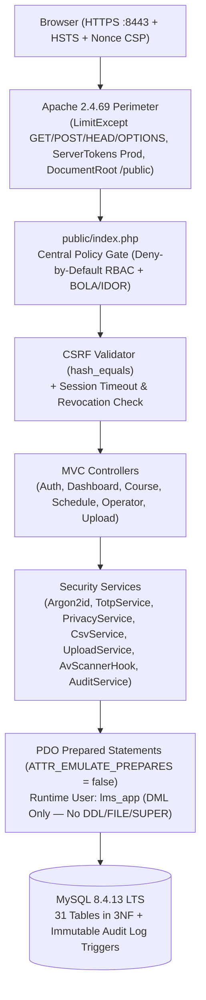
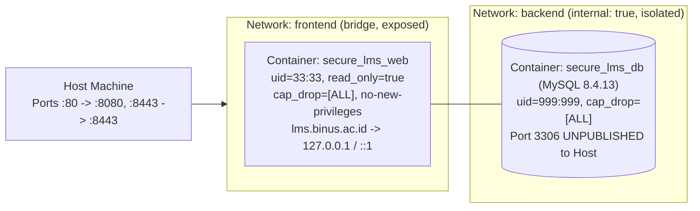

# Secure Neo-Brutalist LMS (OWASP ASVS L2)

A security-first, Neo-Brutalist university Learning Management System (LMS) built for the **Secure Programming (`COMP6695001`)** course assignment. It runs entirely in hardened Docker containers using **Linux + Apache 2.4.69 + MySQL 8.4.13 LTS + PHP 8.5.12**, enforces **OWASP ASVS Level 2** and **OWASP Top 10 (2021)** controls, and is populated with real, pseudonymized Term `2610` (`2026, Odd Semester`) course, session, forum, and schedule data.

---

## 1. One-Command Quick Start

```bash
cd /home/wkali/teamwork_projects/secure_lms
php scripts/generate_env.php   # Generates .env if not already present
docker compose up -d --build
```

- **HTTPS Application URL**: `https://localhost:8443` (HTTP on port `80` redirects permanently to HTTPS `8443`).
- **Retrieve One-Time Seeded Role Credentials**:
  During container startup (or by re-running the idempotent offline importer), random passwords for the 3 roles (`student`, `lecturer`, `operator`) are generated, hashed with Argon2id, and printed once to stdout:
  ```bash
  docker compose exec web php scripts/import_lms_data.php
  ```
- **Run Complete Automated Security & Role Matrix Test Suite**:
  ```bash
  docker compose exec web composer test
  # Or directly from host/container:
  ./scripts/run_tests.sh
  ```

---

## 2. Verified Software Versions & End-of-Life (EOL) Schedule

All versions were verified from official upstream sources (`php.net/supported-versions`, `dev.mysql.com`, `httpd.apache.org`) as of October 2026 and pinned in `docker/web/Dockerfile`, `compose.yaml`, and `composer.lock`:

| Component | Pinned Version / Image | Official Active Support Until | Security Support (EOL) | How to Update |
|-----------|------------------------|-------------------------------|------------------------|---------------|
| **PHP** | `8.5.12` (`php:8.5.12-apache-trixie`) | December 31, 2027 | **December 31, 2029** | Bump tag in `docker/web/Dockerfile` (`FROM php:8.5.x-apache-trixie`) and run `docker compose up -d --build`. |
| **Apache HTTP Server** | `2.4.69` (bundled in Debian Trixie image) | Continuous 2.4.x GA branch | **Active (ASF 2.4 branch)** | Rebuild `web` image with `docker compose build --pull web` to pick up Debian security patches. |
| **MySQL Server** | `8.4.13` LTS (`mysql:8.4.13`) | April 30, 2029 (Premier) | **April 30, 2032** (Extended) | Update `image: mysql:8.4.x` in `compose.yaml` and run `docker compose up -d db`. |
| **Composer** | `2.8.12` (`composer:2.8.12`) | Continuous 2.x LTS | **Active** | Update `FROM composer:2.8.x` in `docker/web/Dockerfile` and run `composer update --lock`. |

### Justification: `php:8.5.12-apache-trixie` Hardened Container Architecture
We selected the official `php:8.5.12-apache-trixie` runtime running as unprivileged user `www-data` (`33:33`) on high ports (`8080`/`8443`) with a **read-only root filesystem** (`read_only: true`), `cap_drop: [ALL]`, and `no-new-privileges: true`. Compared to running a multi-container FastCGI proxy over TCP, running Apache + PHP inside a single read-only, capability-dropped security boundary eliminates cleartext internal FastCGI socket exposure while allowing Apache's perimeter directives (`<LimitExcept GET POST HEAD OPTIONS>`, `TraceEnable Off`, `ServerTokens Prod`, TLS 1.2/1.3, and `a2dismod autoindex status`) to protect the PHP runtime directly.

---

## 3. Architecture & Dual-Network Isolation Diagrams

### A. Application & Security Architecture


### B. Docker Network & Container Hardening Topology


---

## 4. Strict 3-Menu Navigation & Role Capabilities

The sidebar contains **only 3 menus** (`Dashboard`, `Courses`, `Schedule`) for every role, while Profile, Password Re-authentication, TOTP 2FA, Session Revocation, and Personal Data JSON Export live in the top-right **Avatar Menu**:

1. **Dashboard (`/dashboard`)**:
   - **Student**: Strictly shows **ONLY** *Upcoming Class* (type badge, course, class code `LC07`/`LD07`, session number, room/link, time, countdown, progress) and *Latest Forum Posts* (pseudonymized author alias, role badge, timestamp, title, course).
   - **Lecturer**: Next class to teach + *Needs Attention* panel (pending excuses, ungraded items, reported posts, pending groups).
   - **Operator**: System counters (active users, today's classes, pending tickets) + Service Ticket Queue.
2. **Courses (`/courses` & `/courses/{id}`)**:
   - Lists Term `2610` (`2026, Odd Semester`) **`LEC` courses only** (`LAB` category skipped): `COMP6873001`, `COMP6646001`, `COMP6800001`, `COMP6597001`, `COMP6696001`, `COMP6843001`, `COMP6695001`, `ENPR6312001`.
   - Inside each course, displays **only 3 sessions** (`MAX_VISIBLE_SESSIONS = 3`, Sessions 5, 6, 7), including full Session 7 (`Review I`) learning outcomes, 6 sub-topics, and 19 materials for `COMP6695001`.
   - **5 Course Tabs**: `Forum`, `Gradebook`, `People`, `Grouping`, `Attendance`.
3. **Schedule (`/schedule`)**:
   - Monthly calendar + agenda view in `GMT+7` with Neo-Brutalist badges for `Onsite Class`, `Virtual Class`, `Online`, `Onsite Exam`, and `Assignment`, type/date filters, today highlight, and personal `.ics` export (`/schedule/export.ics`).

---

## 5. Additional Documentation
- [`docs/data-sources.md`](file:///home/wkali/teamwork_projects/secure_lms/docs/data-sources.md): Burp MCP discovery, screenshot fallback documentation, and offline import pipeline.
- [`docs/security.md`](file:///home/wkali/teamwork_projects/secure_lms/docs/security.md): Full Action × Role matrix, STRIDE threat model, OWASP Top 10 / ASVS L2 code mappings, `composer audit` & container security report, and self-review checklist.
