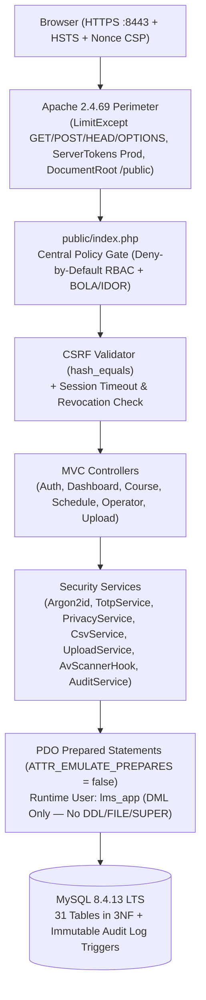
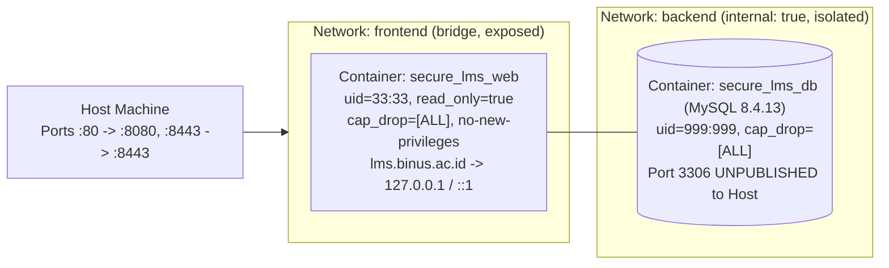

# Secure Neo-Brutalist LMS (OWASP ASVS L2)

A security-first, Neo-Brutalist university Learning Management System (LMS) built for the **Secure Programming (`COMP6695001`)** course assignment. It runs entirely in hardened Docker containers using **Linux + Apache 2.4.69 + MySQL 8.4.13 LTS + PHP 8.5.12**, enforces **OWASP ASVS Level 2** and **OWASP Top 10 (2021)** controls, and is populated with real, pseudonymized Term `2610` (`2026, Odd Semester`) course, session, forum, and schedule data.

---

## 1. One-Command Quick Start

```bash
cd /home/wkali/teamwork_projects/secure_lms
php scripts/generate_env.php   # Generates .env if not already present
docker compose up -d --build
```

- **HTTPS Application URL**: `https://localhost:8443` (HTTP on port `80` redirects permanently to HTTPS `8443`).
- **Stop / Restart the Application**:
  ```bash
  docker compose stop   # Pause containers without losing database changes
  docker compose start  # Resume containers
  docker compose down   # Stop and remove containers (MySQL volume is preserved)
  ```
- **Re-seed / Reset Dummy Credentials**:
  ```bash
  docker compose exec web php scripts/import_lms_data.php --reset-passwords
  ```
- **Run Complete Automated Security & Role Matrix Test Suite**:
  ```bash
  docker compose exec web composer test
  # Or directly from host/container:
  ./scripts/run_tests.sh
  ```

---

## 2. Dummy Login Credentials (All 6 Accounts Across 3 Roles)

All accounts below are **100% synthetic, pseudonymized dummy accounts** (`@lms.ac.id`) hashed with **Argon2id** (`memory_cost=65536`, `time_cost=4`, `threads=1`). No real-world credentials, NIMs, or personal tokens are stored in this repository.

| Role | Pseudonymized Full Name | Alias ID | Email / Username | Dummy Password | Assigned Scope / Courses |
|------|-------------------------|----------|------------------|----------------|--------------------------|
| **Student 1** | `Sora Bauer` | `STD-220725` | `sora.bauer@lms.ac.id` (`student1`) | `Lms#86bce5186214!9A` | Enrolled in all 4 `LEC` courses (`COMP6695001`, `COMP6800001`, `COMP6646001`, `COMP6843001`) |
| **Student 2** | `Julian Takahashi` | `STD-411281` | `julian.takahashi@lms.ac.id` (`student2`) | `Lms#b7fca94c6d54!9A` | Enrolled in all 4 `LEC` courses (`COMP6695001`, `COMP6800001`, `COMP6646001`, `COMP6843001`) |
| **Student 3** | `Klara Novak` | `STD-642656` | `klara.novak@lms.ac.id` (`student3`) | `Lms#8570f8613840!9A` | Enrolled in all 4 `LEC` courses (`COMP6695001`, `COMP6800001`, `COMP6646001`, `COMP6843001`) |
| **Lecturer 1** | `Prof. Adrian Keller` | `LEC-4523` | `adrian.keller@lms.ac.id` (`lecturer1`) | `Lms#17f9232c1856!9A` | Teaches **2 courses**: `COMP6695001` (*Secure Programming*) & `COMP6646001` (*Computer Forensic*) |
| **Lecturer 2** | `Prof. Naomi Vance` | `LEC-8125` | `naomi.vance@lms.ac.id` (`lecturer2`) | `Lms#9b514d78632e!9A` | Teaches **2 courses**: `COMP6800001` (*Human and Computer Interaction*) & `COMP6843001` (*Linux Scripting and Shell Programming*) |
| **Operator (Support Officer)** | `Ops. Oscar Lindqvist` | `OPS-01` | `oscar.lindqvist@lms.ac.id` (`operator`) | `Lms#81a3eabe8551!9A` | **[1]** View & Edit Student/Lecturer Data (`5` accounts)<br>**[2]** Change Course Session Date (`6` sessions per course, fixed 100-min shifts) |

---

## 3. Verified Software Versions & End-of-Life (EOL) Schedule

All versions were verified from official upstream sources (`php.net/supported-versions`, `dev.mysql.com`, `httpd.apache.org`) as of October 2026 and pinned in `docker/web/Dockerfile`, `compose.yaml`, and `composer.lock`:

| Component | Pinned Version / Image | Official Active Support Until | Security Support (EOL) | How to Update |
|-----------|------------------------|-------------------------------|------------------------|---------------|
| **PHP** | `8.5.12` (`php:8.5.12-apache-trixie`) | December 31, 2027 | **December 31, 2029** | Bump tag in `docker/web/Dockerfile` (`FROM php:8.5.x-apache-trixie`) and run `docker compose up -d --build`. |
| **Apache HTTP Server** | `2.4.69` (bundled in Debian Trixie image) | Continuous 2.4.x GA branch | **Active (ASF 2.4 branch)** | Rebuild `web` image with `docker compose build --pull web` to pick up Debian security patches. |
| **MySQL Server** | `8.4.13` LTS (`mysql:8.4.13`) | April 30, 2029 (Premier) | **April 30, 2032** (Extended) | Update `image: mysql:8.4.x` in `compose.yaml` and run `docker compose up -d db`. |
| **Composer** | `2.8.12` (`composer:2.8.12`) | Continuous 2.x LTS | **Active** | Update `FROM composer:2.8.x` in `docker/web/Dockerfile` and run `composer update --lock`. |

### Justification: `php:8.5.12-apache-trixie` Hardened Container Architecture
We selected the official `php:8.5.12-apache-trixie` runtime running as unprivileged user `www-data` (`33:33`) on high ports (`8080`/`8443`) with a **read-only root filesystem** (`read_only: true`), `cap_drop: [ALL]`, and `no-new-privileges: true`. Compared to running a multi-container FastCGI proxy over TCP, running Apache + PHP inside a single read-only, capability-dropped security boundary eliminates cleartext internal FastCGI socket exposure while allowing Apache's perimeter directives (`<LimitExcept GET POST HEAD OPTIONS>`, `TraceEnable Off`, `ServerTokens Prod`, TLS 1.2/1.3, and `a2dismod autoindex status`) to protect the PHP runtime directly.

---

## 4. Architecture & Dual-Network Isolation Diagrams

### A. Application & Security Architecture


### B. Docker Network & Container Hardening Topology


---

## 5. Role Capabilities & Navigation

- **Student & Lecturer Sidebar (`3` Menus)**: `[1] Dashboard`, `[2] Courses`, `[3] Schedule`.
- **Operator Sidebar (`2` Menus)**: `[1] Dashboard`, `[2] Courses` (and `/operator/users` for Student/Lecturer & Course Session Date management).

1. **Dashboard (`/dashboard`)**:
   - **Student**: Strictly shows **ONLY** *Upcoming Class* (type badge, course, class code `LC07`, session number, room/link, time, countdown, progress) and *Latest Forum Posts* (pseudonymized author alias, role badge, timestamp, title, course).
   - **Lecturer**: Next class to teach + *Needs Attention* panel (ungraded items and reported forum posts for their 2 assigned courses).
   - **Operator**: System counters (5 Student & Lecturer accounts, 4 `LEC` courses, 24 total sessions) + quick navigation to Operator Management (`/operator/users`).
2. **Courses (`/courses` & `/courses/{id}`)**:
   - Lists Term `2610` (`2026, Odd Semester`) **4 active `LEC` courses**: `COMP6695001` (*Secure Programming*), `COMP6800001` (*Human and Computer Interaction*), `COMP6646001` (*Computer Forensic*), and `COMP6843001` (*Linux Scripting and Shell Programming*).
   - Inside each course, displays **all 6 sessions (`Sessions 1–6`)**, including learning outcomes, sub-topics, and session materials.
   - **Per-Session Isolated Forums**: Inside the `Forum` tab, each session (`Session 1` through `Session 6`) has its own isolated discussion forum (`6` distinct forums per course, `24` across all 4 courses).
   - **Direct-Join Group Slots**: Lecturers open group slots (`Max Members`), and students can join open group slots directly without requiring lecturer approval.
3. **Schedule (`/schedule` — Student & Lecturer)**:
   - Interactive **October 2026** and **November 2026** monthly calendar grids dynamically synced with MySQL `schedule_entries` + chronological agenda view in `GMT+7` with type/date filters and personal `.ics` export (`/schedule/export.ics`).
4. **Operator Management (`/operator/users`)**:
   - **[1] View & Edit Student Data & Lecturer Data**: Manage full name, email, academic title, active status, and Argon2id password reset for the 5 Student & Lecturer accounts.
   - **[2] Change Course Session Date**: Filter by Course (`COMP6695001`, `COMP6800001`, `COMP6646001`, `COMP6843001`) to view its 6 sessions and update session dates using fixed 100-minute university lecture shifts (`09:20–11:00`, `11:20–13:00`, `13:20–15:00`, `15:20–17:00`, `17:20–19:00`), automatically syncing both `course_sessions` and `schedule_entries`.

---

## 6. Additional Documentation
- [`docs/data-sources.md`](file:///home/wkali/teamwork_projects/secure_lms/docs/data-sources.md): Burp MCP discovery, screenshot fallback documentation, and offline import pipeline.
- [`docs/security.md`](file:///home/wkali/teamwork_projects/secure_lms/docs/security.md): Full Action × Role matrix, STRIDE threat model, OWASP Top 10 / ASVS L2 code mappings, `composer audit` & container security report, and self-review checklist.
